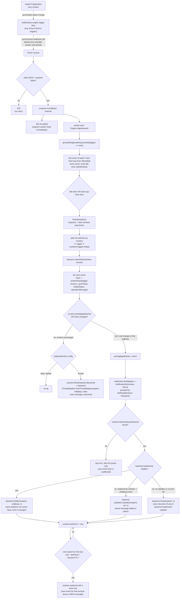

# Design

This document explains how argocd-notifier works and why we built it this way.

## Problem

The ArgoCD notifications-engine sends one message for each `Application`. An ApplicationSet can deploy one service to many clusters. All the `Application` objects share a label, for example `application/name: sample`. In this case, one fleet-wide deploy or incident causes one notification for each cluster. Consider a service that is deployed to 18 clusters. It causes 18 separate messages for what a person thinks of as one event.

argocd-notifier sits between the ArgoCD notifications-engine and one or more **notification backends**. A backend is a separate process, in any language. It registers itself with the core. It renders the message and delivers it to the target system, for example Slack, email or PagerDuty.

The core receives one webhook call each time a trigger fires for an `Application`. It groups the events that share a label. It keeps **one live message for each rollout** and edits this message in place when more events arrive. It does not post a new message each time.

The debounce, session and deduplication logic is the hard and valuable part. It is fully independent of the backend.

## Components

| Package | Responsibility |
|---|---|
| `internal/event` | The wire contract with ArgoCD. It defines the JSON shape that a webhook call decodes into. It checks the fields that the rest of the system needs. |
| `internal/receiver` | The HTTP handler that decodes, checks and enqueues an event, and sends a fast `202` response. It also has the worker pool that drains the queue. |
| `internal/aggregator` | The debounce engine (`Engine`) that batches the events of each group. It also has the session store (`SessionPublisher`), which turns batches into backend posts and updates through a `BackendResolver`. |
| `internal/notification` | The domain model that does not depend on a backend (`Notification`, `Item`). It builds the model from the per-app state of a session. It also defines the interfaces `Backend`, `Updater`, `ThreadReplier` and `Notifier`. The core calls a resolved backend through them. |
| `internal/registry` | The in-memory record of registrations. A backend calls `POST /v1/backends/register` to become routable under its declared name. This call is also its heartbeat. |
| `internal/remotebackend` | Adapts a registry entry to something that `SessionPublisher` can call. It sends `Notify` and `PostThreadReply` over HTTP. It checks the registry again on every call. See [remote-backends.md](remote-backends.md). |
| `internal/slack` | The Slack rendering and client code (Block Kit, `chat.postMessage`, `chat.update`). The core binary does not include it. `internal/slackbackend` wraps it behind its HTTP contract as its own process, `cmd/slack-backend` (see [remote-backends.md](remote-backends.md)). |
| `internal/leader` | Leader election, to run more than one replica safely (see [High availability](#high-availability)). |
| `internal/leaderproxy` | Routing of each request after a leader is elected. A leader handles the request locally. A non-leader forwards it through a reverse proxy to the leader (see [High availability](#high-availability)). |
| `internal/config` | The configuration of all the packages above. It reads environment variables. |
| `cmd/argocd-notifier` | Connects all the parts and runs the HTTP server. |

## Why a debounce window, not just batching

The debounce uses two timers:

- **An idle-reset timer (`IDLE_WINDOW`).** It restarts each time a new event arrives in the same group.
- **A hard cap (`MAX_WAIT`).** It is independent and never restarts.

The timer that fires first flushes the batch. The timers set how often a backend gets a request. They do **not** set how long the message of a rollout stays live. The session does that (see below).

Each timer prevents a different problem:

- Without the hard cap, a group that keeps receiving events in quick succession can delay its first notification without limit. A slow rolling deploy is an example.
- Without the idle reset, a burst of events that arrive almost at the same time splits across more than one debounce window. They do not batch into one message.

## Sessions: why messages update in place

The message of a destination represents one *session*. By default, the key of a session is `(groupKey, revision)`. If you set `COMBINE_TRIGGERS=false`, the key is `(groupKey, revision, trigger)`. In that case, a wave of successful deploys and a wave of degraded health for the same revision never share a message.

Each debounce flush for an existing session asks the resolved backend to edit the same message reference. It does not ask for a new post. How the backend does this depends on the backend (see "Rendering and delivery" below).

The session keeps a `perApp` map. It holds the *latest* known event of each app (last write wins). For this reason, the message always shows the current state. It does not show only the change since the last flush.

A session expires after `SESSION_TTL` without activity. A later event for the same revision then starts a new message. It does not edit a message that is far out of view.

## Duplicate events: no standalone dedup cache

ArgoCD delivers webhooks at least once. The payload has no send ID. For this reason, you cannot distinguish the network retry of an event from a real recurrence of the same status. An example of a real recurrence is an app that reports "Degraded" twice, days apart.

Two facts make this manageable without a separate dedup cache:

1. **Retries in the same debounce window are harmless.** They merge into the same `perApp` entry (last write wins, identical values). The batch still produces exactly one render and one post for each flush.
2. **For an event in a later window**, the session compares the content hash of the new event with the last recorded entry of the app. The hash covers `trigger|revision|syncPhase|healthStatus|operationMessage`.
   - A real change always updates the main message. A refinement of the status with the same trigger is a real change, for example `Error` to `Failed`.
   - The setting `DUPLICATE_ACTION` controls identical content:
     - `"drop"` (default): The session does nothing. This matches a naive dedup. It makes no extra backend calls.
     - `"thread"`: The session sends a short plain-text reply under the message of the session. It does this only if the resolved backend currently declares `supportsThreadReply`. The main message does not change.

A thread reply is truthful in both cases. A retry and a real recurrence both mean "this is still true" or "this is true again". If the session treats an unclear case as a real recurrence, the cost is low. You do not need to guess correctly.

## Rendering and delivery

`notification.Build` sorts the apps by name to get a deterministic output. It builds one `Item` for each app. The `Item` does not depend on a backend. A builder for each trigger makes it. There is one builder for each built-in ArgoCD trigger: `on-created`, `on-deleted`, `on-deployed`, `on-health-degraded`, `on-sync-failed`, `on-sync-running`, `on-sync-status-unknown` and `on-sync-succeeded`.

If the trigger of an event is not known, `Build` leaves the event out of the item list. It still counts the event in the summary line of the notification.

An `Item` holds structured fields: `CommitURL`, `CommitSHA`, `TriggeredBy`, `Images` and a generic `Fields` list. It does not hold the markup of any backend. Each backend turns the fields into a message. It does this fully outside this process (see [remote-backends.md](remote-backends.md)).

The aggregator never talks to the real API of a backend. Every backend is a separate process. It registers itself in `internal/registry`. The core reaches it over HTTP through `internal/remotebackend` (`POST /notify` and `POST /thread-reply`).

ArgoCD calls the core of argocd-notifier through a `service.webhook.<name>` notifier (see [setup.md](setup.md) for the ArgoCD side). The core then calls the backend that the `backend` field of the event names.

The core reuses the existing list of channels or recipients of each app unchanged. The value of the subscribe annotation passes through as `.recipient` in the webhook body. For this reason, the ArgoCD side has no new configuration for each app, except the `application/backend` label (see [setup.md](setup.md)).

Recipient is a routing decision for **each app**. It is really a decision for each trigger, because it comes from the subscribe annotations of each Application. It does not mean "who is copied on one shared message".

- Before rendering, the session groups the apps by the `(backend, recipient)` pair of the latest event of each app.
- A service that deploys to many clusters can route different subsets of apps to different destinations in the same session. It can even use different backends. For example, the sync events of dev clusters go to one Slack channel. The sync events of prod clusters go to another channel. A separate backend sends pages for health-degraded events.
- Each `(backend, recipient)` pair gets its own notification. The notification has only the apps that are addressed to this pair. The pair also has its own message reference, which the session tracks independently.
- Two backends that share a recipient string never collide. Neither sees the apps of the other, although they belong to the same `(groupKey, revision)` session.
- An event can name more than one recipient, joined with semicolons. The app then goes to all of them with the same content.

A resolved backend does one of two things:

- It implements `notification.Notifier`. It decides itself whether to post or to update, and it returns the ref that represents the result. Every remote backend works this way.
- It implements the older trio `Backend`, `Updater` and `ThreadReplier`. `Post` is required. `Updater` and `ThreadReplier` are optional, and the core checks them with a type assertion. We keep the trio for the interfaces themselves.

If an event names a backend that cannot be resolved now, only that `(backend, recipient)` group fails for the current flush. The backend was never registered, or its registration is stale. The core logs the failure. The rest of the session is not affected. See [adding-a-backend.md](adding-a-backend.md) to add a backend.

## Flow

## High availability

If you run more than one replica, you must enable leader election (`LEADER_ELECTION_ENABLED=true`). Without it, a Kubernetes `Service` shares the ArgoCD webhook calls between the replicas. Each replica keeps independent in-memory state. This causes the problem that this service exists to solve: many messages instead of one.

Leader election gives **fast failover and no split-brain. It does not make the state durable.** Exactly one replica is active at any time. `internal/leader.Elector` competes for a `coordination.k8s.io/v1` `Lease`.

**Readiness does not depend on leadership.**
- `/readyz` is intentionally *not* gated on leadership. Every replica reports ready and stays a normal Service endpoint.
- We tried to gate it on `IsLeader` and reverted this change. With N replicas, N-1 pods are never Ready. The rollout of the Deployment can then never report "available". It stays in `Progressing` without end.

**Routing depends on the request.** `internal/leaderproxy.Handler` decides for each request:
- The leader handles the request locally.
- A non-leader forwards the request through a reverse proxy to the replica that holds the lease.

**Finding the leader.**
- `internal/leader.PodAddressResolver` finds the address of the leader. It makes a `Pods.Get` call to the Kubernetes API. It caches the address until the leader changes. It needs read-only RBAC on `pods`.
- We first tried a DNS approach and reverted it. Per-pod DNS records need a unique and stable hostname for each replica. A Deployment cannot give this. Only a StatefulSet assigns it automatically.

**Failover window.** Directly after a failover, no leader can be known for a short time. In this window, a non-leader returns `503` for that one request. The webhook client of ArgoCD logs it and retries it, as it does for any 5xx. This is not a probe or rollout problem.

**State after a failover.**
- The new leader starts with empty in-memory session state, as after a normal restart.
- To keep the session state after a leader change, the service needs external state, for example Redis. The state includes the message refs that are in progress. This is deliberately out of scope.
- The new leader also starts with no registered backends. Backends must register again at regular intervals. One registration is not enough. See the heartbeat section of [remote-backends.md](remote-backends.md).

For the required RBAC, see [README.md](../README.md#high-availability).

## Debugging

When `PPROF_ENABLED=true`, `net/http/pprof` runs on its own listener (`PPROF_ADDR`, default `:6060`). It is registered on a dedicated mux, not on `http.DefaultServeMux`. It is deliberately separate from the main server. For this reason, no route that carries ArgoCD webhook traffic or readiness checks can reach it. For the `port-forward` and `go tool pprof` commands, see [setup.md](setup.md).

## Known limitations (accepted, not accidental)

- **In-memory state, no persistence.** A pod restart during a rollout loses the mapping from session to message. The next event for that revision posts a new message. It does not edit the old message. We accept this as a trade-off for a rare case. Restarts must be rare. We must fix their root causes, for example OOM kills. We must not hide them with dedup machinery.
- **No awareness of the fan-out count.** A message can say "3 apps degraded". It cannot say "3 of 20". The notification payload of ArgoCD has no information about how many other Applications share a label. To get it, the service needs a separate watch or informer on the Application CRD. This is deferred.
- **`cmd/slack-backend` is the only backend that ships today.** It wraps the rendering and client code of `internal/slack` behind the HTTP contract of `internal/slackbackend`. It registers itself as its own process.
  - If the `backend` of an event never registers (wrong name or backend down), the `(backend, recipient)` group fails on every flush. The core logs it. It is not fatal.
  - If you run more than one replica of `cmd/slack-backend`, you do not yet get real HA.
- **No fan-out to multiple backends for each event.** An event routes to exactly one backend, by name. If you run several backends, different events go to different single destinations. The same notification is not broadcast to all of them.
- **The limit of 100 attachments is a hardcoded default in `internal/slack`.** You cannot configure it yet. Slack does not publish an exact threshold in bytes that we could guard against separately. Revisit this if the number of apps in one rollout grows enough to matter.
